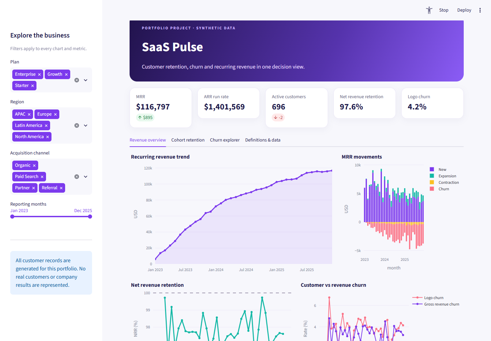
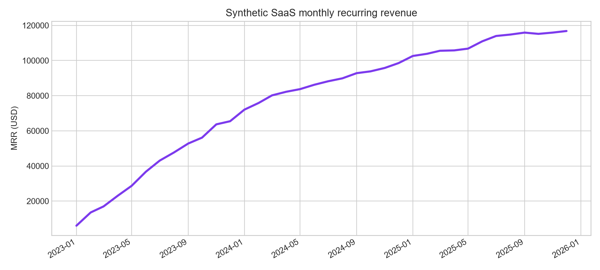
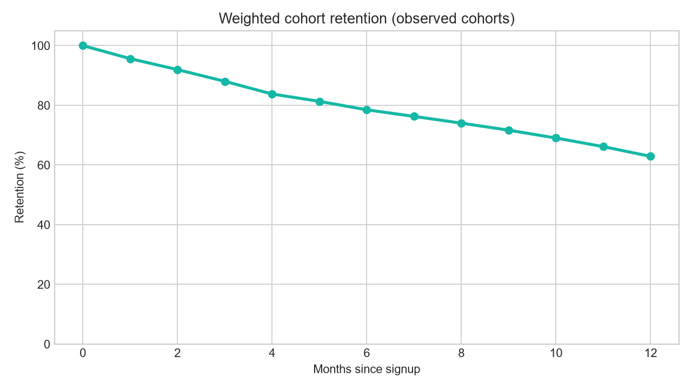

# SaaS Pulse — Customer Churn & Revenue Analytics



An end-to-end data analyst portfolio project covering deterministic data generation, customer-month ETL, SQL business metrics, Python EDA, quality tests, and an interactive Streamlit dashboard. **Every customer and dollar amount is synthetic.** The project is designed for demonstration and does not describe a real company.

## Business questions

1. Is recurring revenue growing, and which movements explain the change?
2. Are existing customers expanding enough to offset contraction and churn?
3. How does signup-cohort retention change with customer age?
4. Which plan and acquisition-channel segments have the highest churn?

## Dashboard





The app has revenue, cohort, churn, and methodology views. Filters for plan, region, channel, and reporting months update the analysis; a CSV download exports the selected segments. Charts are interactive in the running app. The first image is a local dashboard screenshot; the next two are reproducible EDA figures. No cloud deployment is implied.

[View the local cohort dashboard screenshot](reports/dashboard_cohorts.png).

## Repository map

```text
app.py                       Streamlit dashboard
data/raw/                    Generated synthetic customer source
data/processed/              Reproducible customer-month ledger
src/generate_data.py         Fixed-seed source generator
src/etl.py                   Validation and revenue-movement ETL
src/eda.py                   EDA figures and summary
sql/                         DuckDB analyses with CTEs and windows
tests/                       Pipeline and SQL checks
reports/                     Generated analysis figures and summary
.streamlit/config.toml       Dashboard theme
DEPLOYMENT.md                GitHub and Streamlit deployment steps
```

## Quick start

Use Python 3.11 or 3.12 for the closest match to a typical Streamlit Community Cloud deployment.

```bash
python -m venv .venv
# Windows PowerShell: .venv\Scripts\Activate.ps1
# macOS / Linux: source .venv/bin/activate
python -m pip install -r requirements-dev.txt
python -m src.generate_data
python -m src.etl
python -m src.eda
python -m pytest -q
streamlit run app.py
```

The processed CSV and EDA outputs are committed for immediate deployment. Re-running the commands recreates them from fixed seeds. `streamlit run app.py` opens the dashboard locally.

## Dataset provenance and grain

`data/raw/synthetic_customers.csv` is generated in this repository by `src/generate_data.py` with NumPy seed 42. It contains 1,400 fictional customers with signup month, fixed acquisition plan, region, channel, base MRR, and optional churn month. Dates range from January 2023 through December 2025. The generator assigns illustrative plan and channel effects to churn probability; these are simulation assumptions, **not causal findings**.

`src/etl.py` uses seed 2024 to create at most one row per customer per month. A row contains opening MRR, closing MRR, mutually exclusive revenue movements, and active/churn flags. A customer who churns receives one final row with zero closing MRR; no reactivations occur. Later rows for that customer are absent. Subscription changes are modeled as occasional 20% expansions and 15% contractions. USD is the sole currency.

## Metric definitions

| Metric | Definition | Interpretation |
|---|---|---|
| Closing MRR | Sum of customer MRR at month end | Subscription run rate in USD |
| ARR run rate | 12 × closing MRR | Annualized run rate, not recognized revenue |
| New MRR | MRR from customers first active this month | Excluded from NRR |
| Expansion / contraction MRR | Increase / decrease for retained customers | Positive magnitudes |
| Churned MRR | Prior MRR from customers whose subscription ends this month | Positive magnitude |
| Logo churn | Churned customers ÷ active customers at month start | Monthly customer-loss rate |
| Gross revenue churn | (Contraction + churned MRR) ÷ opening MRR | Existing-customer revenue lost before expansion |
| NRR | (Opening MRR + expansion − contraction − churned MRR) ÷ opening MRR | Existing-customer revenue retention |
| Cohort logo retention | Active customers at age *n* ÷ original signup cohort size | Unobserved future ages are blank |
| ARPA | Closing MRR ÷ active customers | Monthly average revenue per active account |
| LTV proxy | ARPA ÷ monthly logo churn | Simple steady-state estimate; null at zero churn |
| Realized customer revenue | Sum of observed monthly MRR | Active customer histories are right-censored |

Monthly MRR reconciles as **closing = opening + new + expansion − contraction − churn**. The SQL analyses use `NULLIF` to avoid misleading divide-by-zero values. The first reporting month has no prior-month growth rate. Rates for a filtered segment use that segment's opening population; a reporting-date slider changes the display period but does not reset opening balances.

The LTV proxy is illustrative: it assumes stationary churn, constant ARPA, and 100% gross margin. It is not discounted and includes no acquisition cost. Avoid presenting it as a validated valuation or true lifetime forecast. Cohort age is measured in whole calendar months. Customers who churn remain in cohort denominators, including after their final ledger row.

## SQL and analysis workflow

The SQL files are DuckDB-compatible and query a table or registered DataFrame named `customer_months`:

- `01_monthly_kpis.sql`: movement bridge, churn, NRR, ARPA, ARR, LTV proxy, and prior-month growth using `LAG`.
- `02_cohort_retention.sql`: full observed cohort-age grid and logo retention.
- `03_segment_churn.sql`: plan/channel churn with a three-month weighted rolling rate using window frames.
- `04_customer_lifetime.sql`: observed revenue, censoring status, and quartiles with `NTILE`.

`src/eda.py` runs the first two queries, plots MRR and retention, and writes a data-quality snapshot to `reports/eda_summary.md`.

## Quality and limitations

The ETL rejects missing required fields and duplicate customer IDs, and checks one row per customer-month plus revenue reconciliation. Tests check deterministic output, churn treatment, SQL reconciliation, cohort bounds, and customer-lifetime coverage. The project intentionally excludes refunds, taxes, discount schedules, partial months, currency conversion, product usage, and reactivations. Synthetic patterns should be used to demonstrate analytical technique rather than assert a market benchmark.

## Deployment

Follow [DEPLOYMENT.md](DEPLOYMENT.md) to push this repository to GitHub and deploy `app.py` on Streamlit Community Cloud. Replace the repository's About text and add your own GitHub and live-app URLs after publishing. No live deployment is claimed by this README.

## Suggested resume line

> Built a reproducible SaaS analytics project using Python, DuckDB SQL, and Streamlit to analyze MRR movements, cohort retention, customer churn, NRR, and segment performance across 1,400 synthetic customer histories; validated revenue reconciliation with automated tests.

## License

MIT — see [LICENSE](LICENSE).
